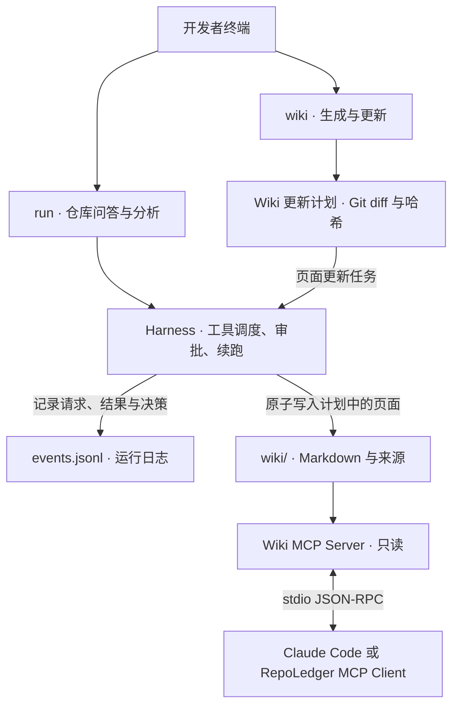
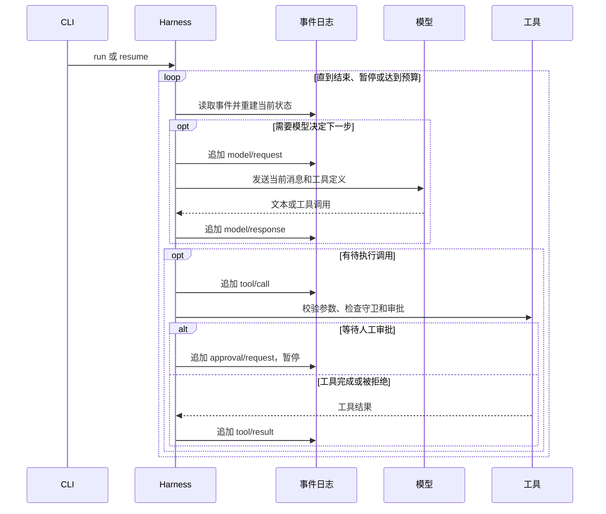

# RepoLedger

[](https://github.com/15016623369a-spe/repoledger/actions/workflows/ci.yml)

**RepoLedger 是一个可续跑的仓库知识库 Agent。** 它从 Git 仓库生成带源码出处的 Wiki，按变更更新受影响的页面，并通过只读 MCP 提供给 Claude Code。运行时把模型调用、工具结果和人工审批写进追加式事件日志，中断后可以续跑，完成后可以回放。

核心仅使用 Python 3.10+ 标准库。生成离线 Wiki、跑演示和测试均无需 API key。

[演示视频](docs/agent-core-demo.mp4) · [运行时设计与使用边界](docs/runtime.md) · [Wiki MCP 与浏览器来源](docs/week3.md) · [策略与评测](docs/wiki-strategy.md)

## 系统架构

RepoLedger 有两个执行入口。`agent run` 运行一个模型驱动的 ReAct 工具循环，`agent wiki` 执行由 Git 变更决定的页面更新计划。两者共用同一套事件日志、审批和续跑机制。生成的 Markdown 由独立的只读 MCP Server 提供查询，Claude Code 可以直接接入。RepoLedger 的运行时也可以通过 MCP Client 按需加载 Wiki 或 Playwright 工具。



### ReAct 运行时如何执行和续跑

CLI 从 `.env` 或环境读取模型设置，装配工具、工作目录与预算。运行时从日志推导消息，向模型请求下一步，校验工具参数及权限，然后把工具结果写回日志。模型根据新证据继续调用工具，或提交答案。



| 机制 | 工程取舍 |
| --- | --- |
| 事件驱动续跑 | `events.jsonl` 是运行状态的依据。日志有工具调用但缺结果时，`resume` 只处理尚未完成的调用。模型请求中断时按日志恢复后重试。工具副作用可能已经发生，允许重放的操作需要考虑幂等性。依赖旧浏览器会话的调用会交回模型重新规划。 |
| 并发与消息协议 | 连续、标记为可并行的只读调用可以并发。写入等有副作用的调用串行执行，日志仍按调用顺序追加。守卫提前结束一轮时，为跳过的调用补结果，保证下一轮消息满足模型接口的工具调用协议。 |
| 跨进程人工审批 | 在需要批准的工具调用产生副作用前写入 `approval/request` 并退出。人工通过 CLI 追加 `approval/decision`，再用 `resume` 继续。运行日志也记录拒绝结果。 |
| 上下文预算 | 运行配置限制轮次、工具次数、输入 token 和运行时间。大工具结果截断后将完整内容保存在运行目录，模型可用 `read_artifact` 取回。滚动摘要保留原事件的序号，`replay` 可以回查原始证据。 |

### Wiki 如何更新与查询

1. **计算需要更新的页面。** 按仓库里 Git 跟踪的文件建立页面来源集合。以页面记录的提交为基线，用 `git diff`、上次记录的未提交路径以及新增来源缩小重算范围，再比较源文件的 SHA-256。来源、生成配置或外部证据发生变化时，才会安排对应页面更新。
2. **生成可核对的正文。** 默认在本地提取索引。启用模型后，给模型提供有长度上限的源码片段，由程序管理来源列表和写入。可选的 Playwright 采集会保存依赖来源的网址、标题、抓取时间和摘录，也支持导入已核对的来源 JSON。
3. **在写入前校验。** 更新计划随 run 保存。原子替换前核对源文件和目标页，发现不一致时提示重新生成。`wiki/AGENTS.md` 草稿先落预览，再走审批。
4. **把 Wiki 当成源码索引。** MCP Server 通过 `list_pages`、`search_wiki` 和 `get_page` 提供目录、字面检索和分页阅读。原生 CLI 做影响分析时可先用 `grep` 找到符号，再用 `read_file` 核对命中附近的代码，最后给出源码路径和行号。需要 Wiki 时再显式加载对应 MCP 配置。

### 关键模块

| 层 | 实现 | 职责 |
| --- | --- | --- |
| 入口与模型 | [cli.py](agent/cli.py) · [llm.py](agent/llm.py) · [settings.py](agent/settings.py) | 组装命令配置、运行策略和 OpenAI 兼容模型接口 |
| 运行与恢复 | [loop.py](agent/loop.py) · [events.py](agent/events.py) · [session.py](agent/session.py) · [approval.py](agent/approval.py) | 推导下一步、追加事件、重建模型消息和审批状态 |
| 工具与预算 | [tools.py](agent/tools.py) · [sandbox.py](agent/sandbox.py) · [context.py](agent/context.py) · [compact.py](agent/compact.py) · [usage.py](agent/usage.py) | 执行守卫与工作区检查、管理上下文并汇总 token 与耗时 |
| 仓库知识 | [wiki.py](agent/wiki.py) · [wiki_sources.py](agent/wiki_sources.py) | 规划增量更新、保存来源和哈希、生成与发布页面 |
| 对外接入 | [wiki_mcp.py](agent/wiki_mcp.py) · [mcp.py](agent/mcp.py) · [skills.py](agent/skills.py) | 提供 Wiki 只读服务，加载允许的外部 MCP 工具，按需读取 Skills 正文 |
| 评测 | [evals/](evals/) | 使用冻结仓库和 Wiki 输入运行配对评测，统计正确率、预算停止、token 与延迟 |

内置文件工具执行工作区路径检查，外部 MCP 工具按白名单注册。启用 `bash` 时，命令受审批和命令检查约束，进程级隔离需由容器等外部环境提供。[运行时设计与使用边界](docs/runtime.md)

## 快速体验

```bash
git clone https://github.com/15016623369a-spe/repoledger.git
cd repoledger
python3 examples/demo.py
python3 -m agent --runs examples/_demo/runs replay repo-impact --events
```

演示用确定性模型驱动真实工具，覆盖异常退出、续跑、上下文压缩及带源码行号的仓库分析。最后一条命令回放分析过程。

## 生成并查询仓库 Wiki

```bash
python3 -m agent wiki . --run-id wiki-v1
python3 -m agent approvals list wiki-v1
# 核对预览后，将 REQUEST_ID 换成上一步显示的编号
python3 -m agent approvals approve wiki-v1 REQUEST_ID
python3 -m agent resume wiki-v1
```

Wiki 默认生成到目标仓库的 `wiki/`，包含架构、模块、设计决策和依赖四页。每页记录依据的路径和 SHA-256。随后可用新的 run ID 再次生成，程序会结合 `git diff` 和来源哈希判断哪些页面需要重写。`wiki/AGENTS.md` 草稿写入前会暂停等待批准。

已安装 Claude Code 时，在仓库根目录注册只读服务。

```bash
claude mcp add --scope project --transport stdio --env PYTHONPATH="$PWD" \
  -- repo-wiki "$(command -v python3)" -m agent wiki-mcp "$PWD"
claude mcp list
```

在 Claude Code 中让 `repo-wiki` 列出页面、搜索主题或读取正文。依赖核对也可以接入 Playwright MCP，采集的网址和时间会保存在 Wiki。[MCP、Skills 和浏览器用法](docs/week3.md)

## 使用真实模型

在 RepoLedger 的项目根目录新建 `.env`，填入你自己的 OpenAI 兼容端点、API key 和模型名。

```dotenv
HARNESS_BASE_URL=https://api.deepseek.com/v1
HARNESS_API_KEY=your_api_key
HARNESS_MODEL=your_model_id
```

```bash
python3 -m agent run "工具耗时数据在哪里记录、在哪里汇总？给出源码行号" \
  --workspace . --no-bash --run-id repo-check
python3 -m agent replay repo-check --usage
```

运行中断后用 `python3 -m agent resume repo-check`。需要实验性的变更影响策略时，追加 `--strategy repo-impact-v2`。需要读 Wiki 时，可显式追加 `--mcp-config examples/mcp.repo-wiki.json`。需要人工确认的写入可使用 `--async-approval`，再通过 `approvals list`、`approve` 或 `deny` 作出决定。

## 真实评测

问答和修复评测在固定版本仓库上使用 Claude Code 与 DeepSeek。成功数按各轮预先定义的判分规则计算。

| 评测 | 结果 |
| --- | --- |
| 30 道仓库问答 | 27 对可比。源码组 27/27，Wiki 组 25/27。Wiki 组两道题事实正确、输出格式不符 |
| 4 个独立修复任务 | 4/4 通过定向测试与全量回归 |
| 40 道 Wiki 净收益试验 | 源码组 28/40，Wiki 组 30/40。配对差的 95% 区间为 −7.5 至 +17.5 个百分点 |
| 12 道新题对照 | 源码组 11/12，Wiki 组 9/12，Wiki + V2 组 11/12。V2 组没有调用 Wiki，较源码组多用 7.56% token |

当前数据不足以证明 Wiki 稳定提高正确率。仓库问答默认检索源码，Wiki 和 V2 由使用者选择开启。原生 CLI 的 V2 路径有离线集成回归，表中的模型成绩来自 Claude Code。[第四周报告](docs/week4.md) · [Wiki 净收益](docs/wiki-net-benefit.md) · [三组对照](docs/wiki-strategy.md)

## 检查与复现

```bash
python3 -W error::ResourceWarning -m unittest discover -s tests
python3 -m unittest discover -s evals -p 'test_*.py'
python3 evals/wiki_holdout.py --verify
```

前两条覆盖运行时与评测脚本。第三条离线核对新题和固定版本的源码证据。重新运行真实模型评测会产生 API 用量，参数见各评测报告。

## 许可证

[MIT](LICENSE)
